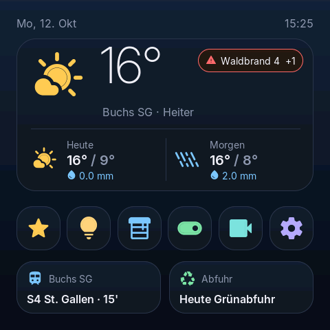
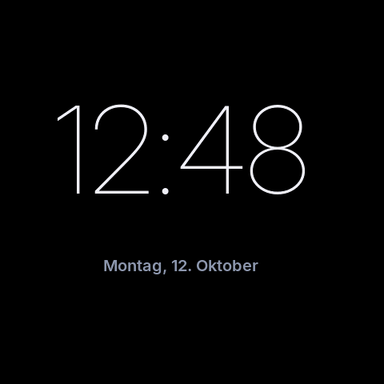
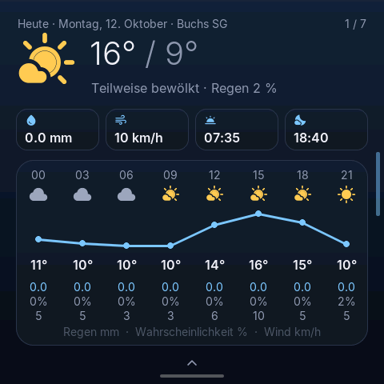
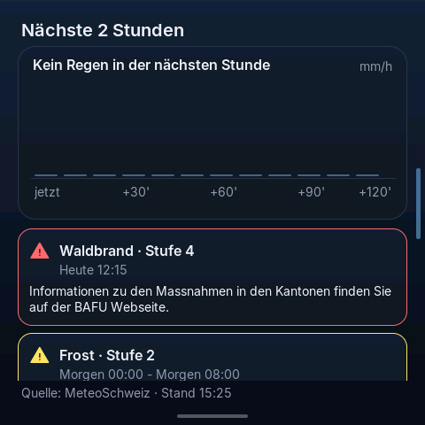
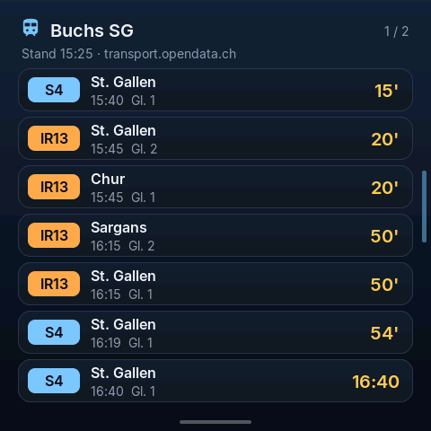
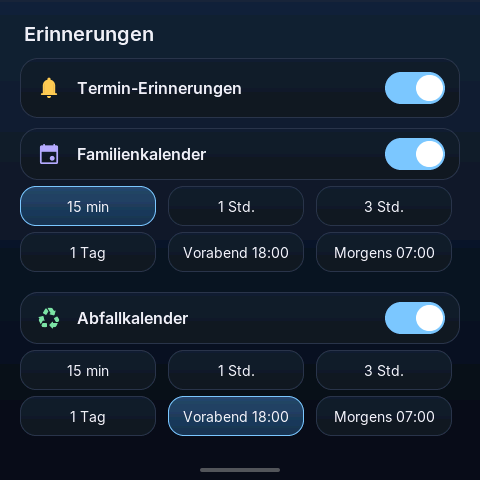
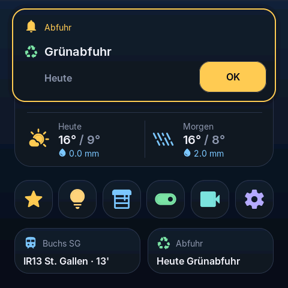
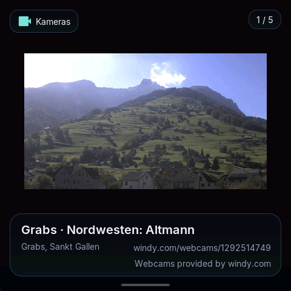
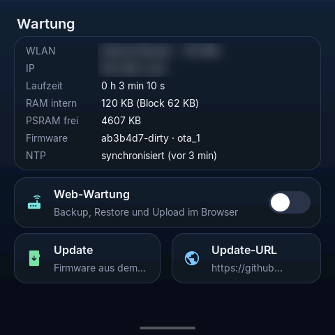

# Wandpanel – allgemeine Anleitung (alle Geräte)

Das Panel ist ein 480×480-Touchdisplay für die Wand oder den Tisch. Es zeigt Wetter, Warnungen, ÖV-Abfahrten, Kalender, Abfuhrtermine, Webcams und Energiedaten an und kann über einen Loxone Miniserver Licht, Storen und Schalter bedienen.

**WLAN und Miniserver sind optional.** Das Panel startet immer auf der Startseite. Ohne WLAN zeigt es die Uhrzeit und die Einstellungen, ohne Miniserver alles ausser der Loxone-Steuerung.

Was nur ein bestimmtes Gerät kann, steht in [panlee.md](panlee.md), [guition.md](guition.md) und [sensecap_d1.md](sensecap_d1.md).

Die Bilder in dieser Anleitung stammen teils von älteren Firmware-Versionen. Texte und Anordnung können leicht abweichen, die Funktionen sind dieselben.

---

## 1. Bedienung

| Geste | Wirkung |
|---|---|
| Tippen | Taste oder Kachel auslösen |
| Wischen links/rechts | Seite wechseln (Kategorien, Wetter-Tage, Kameras, ÖV) |
| Vom unteren Rand nach oben wischen | zurück zur Startseite |
| Vom rechten Rand nach links wischen | zurück zur Startseite |
| In einem Untermenü nach rechts wischen | eine Ebene zurück |
| Berühren bei dunklem Bildschirm | Bildschirm aufwecken. Die Berührung löst sonst nichts aus, ausser «OK» auf einer Erinnerung |

### Startseite

- Oben: Uhrzeit, Wetter am gewählten Ort, Unwetter-Hinweis und eine Taste für die Regenansicht.
- Tastenreihe:
  - **Loxone**: öffnet die Kategorien (Favoriten, Licht, Storen, Schalter).
  - **Schalter**: schaltet direkt das Gerät, das du unter Einstellungen › Orte & Infos › Schalter-Taste gewählt hast.
  - **Kameras**: Webcams.
  - **Einstellungen**.
  - Beim SenseCAP D1 gibt es zusätzlich eine Taste für das Oszilloskop.
- Darunter: nächste ÖV-Abfahrten, nächste Termine bzw. Abfuhr und, falls eingerichtet, Energiedaten.

---

## 2. Erster Start

1. Panel anschliessen (siehe Geräte-Anleitung). Nach wenigen Sekunden erscheint die Startseite.
2. Ist noch kein Miniserver eingetragen, öffnet sich beim allerersten Start einmal das Formular **Miniserver**. Du kannst es ausfüllen oder **Überspringen** wählen (siehe Abschnitt 4).
3. **WLAN einrichten:** Einstellungen › Netzwerk & Zeit › WLAN (siehe Abschnitt 3).
4. Danach lädt das Panel automatisch Uhrzeit, Wetter und die anderen Inhalte.
5. Weitere Einstellungen nach Bedarf: Wetter-Ort, ÖV-Haltestellen, Kalender, Kameras, Erinnerungen, Bildschirm.

---

## 3. WLAN

**Einstellungen › Netzwerk & Zeit › WLAN**

1. Das Panel sucht Netze und zeigt sie mit Signalstärke an. Mit **Abbrechen** stoppst du die Suche.
2. Netz antippen. Bei geschützten Netzen das Passwort über die Bildschirmtastatur eingeben und **OK** drücken.
3. Das neue Netz wird erst gespeichert, wenn die Verbindung steht. Klappt es nicht (z. B. falsches Passwort, Netz nicht in Reichweite), kehrt das Panel nach spätestens 20 Sekunden zum bisherigen Netz zurück.

Gut zu wissen:

- Fällt das WLAN aus, läuft das Panel offline weiter und verbindet sich automatisch wieder, sobald das Netz zurück ist.
- Ist das gespeicherte Netz beim Start 30 Sekunden lang nicht erreichbar, kann die WLAN-Auswahl erscheinen. Dort kannst du ein anderes Netz wählen, mit **Nochmals versuchen** neu verbinden oder mit **Ohne Netzwerk starten** offline weiterarbeiten. Das gilt nur bis zum nächsten Neustart, das gespeicherte Netz bleibt erhalten.
- Das Panel wählt bei mehreren Access Points desselben Netzes den stärksten.

---

## 4. Loxone Miniserver (optional)

**Einstellungen › Netzwerk & Zeit › Miniserver**

| Feld | Eingabe |
|---|---|
| Adresse | IP-Adresse oder Name des Miniservers im lokalen Netz, optional mit Port (`name:8080`). Ohne `http://`. HTTPS wird nicht unterstützt |
| Benutzer | Loxone-Benutzer, den das Panel verwenden soll |
| Passwort | Passwort dieses Benutzers. Wird maskiert angezeigt, leer lassen = unverändert |

Tasten:

- **WLAN**: zuerst WLAN verbinden, falls noch nicht geschehen.
- **Testen**: prüft die Verbindung, ohne zu speichern.
- **Speichern**: übernimmt die Werte.

Tipp: Lege für das Panel in der Loxone Config einen eigenen Benutzer an, der nur die Bausteine sieht, die das Panel steuern soll.

Danach liest das Panel die Steuerungen vom Miniserver und zeigt sie unter **Loxone** an:

- **Favoriten**, **Licht**, **Storen** (Auf, Ab, Position), **Schalter**.
- Der Zustand wird beim Öffnen einer Seite frisch gelesen.
- Ist der Miniserver nicht erreichbar, zeigt das Panel die zuletzt bekannten Kacheln (als offline markiert) und versucht es im Hintergrund erneut (nach 10 s, 30 s, 2 min, dann alle 5 min). Befehle werden erst wieder angenommen, wenn er antwortet.

### Schalter-Taste

**Einstellungen › Orte & Infos › Schalter-Taste**: Wähle, was die Taste „Schalter“ auf der Startseite bedient. Ein Schalter wird bei jedem Tippen umgeschaltet (ein/aus), andere Bausteine erhalten einen Impuls. Ohne Auswahl gilt der erste verfügbare Eintrag.

---

## 5. Einstellungen im Überblick

| Gruppe | Einträge |
|---|---|
| **Netzwerk & Zeit** | WLAN, Uhrzeit (Zeitserver und Zeitzone), Miniserver |
| **Anzeige** | Ausschalten nach, Bildschirmschoner, Design |
| **Orte & Infos** | Wetter-Ort, ÖV, Kalender, Kameras, Erinnerungen, Schalter-Taste |
| **Energie-Quellen** | Co4, whatwatt Go & PV |
| **System** | Wartung & Update, Playground |

Alle Einstellungen bleiben bei Updates und Stromausfällen erhalten. Passwörter und Schlüssel werden am Display nur maskiert angezeigt.

### Uhrzeit

- Zeitserver: `ch.pool.ntp.org` (Standard), `pool.ntp.org`, `ntp.metas.ch`, `time.google.com` oder ein eigener Server.
- Zeitzone: Zürich (Standard), London, UTC, New York.
- Die Uhrzeit kommt aus dem Internet. Ohne WLAN steht unter Wartung „NTP: nicht synchronisiert“.

### Anzeige

- **Ausschalten nach:** Aus (Bildschirm bleibt an), 30 s, 1, 2, 5 oder 10 Minuten.
- **Bildschirmschoner:** Schwarz (optional mit dezentem Hinweis „wake me up“), Digitaluhr oder Analoguhr im Stil der Schweizer Bahnhofsuhr.
- **Design:** „Dark Glass“ (Standard) oder „Co4“. Nach dem Wechsel startet das Panel neu.

|  |  |
|:-:|:-:|
| Digitaluhr | Analoguhr |

Nach dem Aufwecken zeigt das Panel immer die Startseite.

---

## 6. Funktionen

### Wetter

**Einstellungen › Orte & Infos › Wetter-Ort**: Ortsname eingeben, Treffer wählen. Standard ist Buchs SG.

- Startseite: aktuelles Wetter und Aussicht.
- Wetter-Seite: Tage durchblättern, Stundenverlauf mit Temperatur und Regen.
- Regen-Taste: Regenübersicht der nächsten 24 Stunden und ein Regenradar.
- Daten: Open-Meteo (Wetter), RainViewer (Radar).

### Warnungen und Regenprognose (MeteoSchweiz)

- Unwetterwarnungen erscheinen als Hinweis auf der Startseite. Antippen zeigt die Details.
- Die Niederschlagsprognose zeigt die nächsten 2 Stunden in 10-Minuten-Schritten.
- Beides gilt für die im Panel hinterlegte Postleitzahl (Standard Buchs SG). Diese ist unabhängig vom Wetter-Ort und lässt sich am Gerät zurzeit nicht ändern (**offen**). Eine Änderung ist über die Wiederherstellung einer angepassten Sicherung möglich.
- Die Daten stammen aus einer inoffiziellen Schnittstelle von MeteoSchweiz und können ohne Vorwarnung ausfallen.

### ÖV-Abfahrten

**Einstellungen › Orte & Infos › ÖV**: bis zu zwei Haltestellen suchen und speichern.

- Startseite: nächste Abfahrt(en).
- ÖV-Seite: Abfahrtstafel, mit Wischen zwischen den Haltestellen wechseln.
- Daten: transport.opendata.ch.

### Kalender und Abfuhr

**Einstellungen › Orte & Infos › Kalender**

| Eintrag | Bedeutung |
|---|---|
| Familienkalender | geheime iCal-Adresse deines Kalenders (bei Google: „Privatadresse im iCal-Format“). Wird maskiert gespeichert |
| Abfall: Gemeinde | BFS-Nummer der Gemeinde (4 Ziffern, Buchs SG = 3271) |
| Abfall: Zone | Tour/Zone, falls deine Gemeinde mehrere hat (genau wie in der Liste des Abfallkalenders) |
| Abfall: Am Vortag ab | ab welcher Uhrzeit am Vortag der Abfuhr-Hinweis erscheint |
| Abfall: Am Sammeltag bis | bis wann der Hinweis am Abfuhrtag sichtbar bleibt |
| Abfallkalender-API | Adresse des Abfuhrdienstes (nur ändern, wenn du dazu aufgefordert wirst) |

Die Termine erscheinen auf der Startseite und auf einer eigenen Seite. Abfuhrdaten werden beim Start und dann einmal täglich geladen.

### Erinnerungen

**Einstellungen › Orte & Infos › Erinnerungen**

- An/aus, getrennt für Familienkalender und Abfuhr.
- **Termine: Vorlauf**: wie lange vor einem Termin erinnert wird.
- **Ganztägig: Am Vortag ab**: Uhrzeit, ab der am Vortag an ganztägige Termine erinnert wird.
- Abfuhr: über „Am Vortag ab“ und „Am Sammeltag bis“ (siehe oben).

Eine Erinnerung erscheint als Karte auf der Startseite und auch auf dem Bildschirmschoner. Mit **OK** bestätigst du sie. Bestätigte Erinnerungen kommen nicht wieder.

### Kameras

**Einstellungen › Orte & Infos › Kameras**

- Webcams von windy.com: per **+ ID** oder **Ort suchen** (Umkreis 25 km) hinzufügen, bis zu 12 Kameras.
- Dafür ist ein eigener, kostenloser **API-Key** von windy.com nötig (Eintrag **API-Key**).
- Die Bilder werden alle 2 Minuten erneuert.

### Energie

**Einstellungen › Energie-Quellen**

- **Co4:** Anmeldung mit dem Handy, siehe unten.
- **whatwatt Go & PV:**
  - **whatwatt-Adresse**: IP oder Name des whatwatt Go im lokalen Netz, ohne `http://`. Ein Web-Passwort am whatwatt wird nicht unterstützt.
  - **Abfrage-Intervall**: Standard 10 s.
  - **Tarifmodell**: Einheitstarif oder Hoch-/Niedertarif mit HT-Zeiten (Mo–Fr) und optional einem Datum, ab dem automatisch auf HT/NT umgestellt wird.
  - **Einspeisevergütung**, **Einspeisung anzeigen**.
  - **Wasser anzeigen**, **Wasserzähler** (M-Bus-Nummer), **Wasserpreis inkl. Abwasser**.
  - **PV (Growatt) lesen** über ein Modbus-TCP-Gateway: IP, Port (Standard 502), Unit-ID (Standard 1). Das Panel liest nur, es schreibt nie etwas auf den Wechselrichter.

Die Energiedaten öffnest du über die Energie-Anzeige auf der Startseite. Bei Strom gibt es heute (stündlich) und die letzten Tage mit Kosten, beim Wasser Tageswerte (der Zähler meldet sich nur einmal täglich). Die Preise sind voreingestellt und lassen sich anpassen.

### Co4 Energie

**Einstellungen › Energie-Quellen › Co4**

1. **Co4-Konto** › **Co4 anmelden**. Das Panel zeigt einen QR-Code und einen Code.
2. QR-Code mit dem Handy scannen oder die angezeigte Adresse öffnen, den Code bestätigen und dich bei Co4 anmelden. Das Panel speichert dabei kein Passwort.
3. **Zone** › **Zone wählen**: Objekt bzw. Zone auswählen, deren Daten angezeigt werden sollen.
4. Die Co4-Daten (Bezug, Einspeisung, PV, Batterie, Autarkie, Verlauf nach Tag/Monat/Jahr) öffnest du über die Energie-Anzeige auf der Startseite.

Meldungen:

- „Anmeldung abgelaufen“: erneut anmelden.
- „Zone unbekannt – bitte Zone neu wählen“: Die gespeicherte Zone gibt es bei Co4 nicht mehr. Unter **Zone** neu wählen.
- **Co4 abmelden** löscht die Anmeldung im Panel, die gewählte Zone bleibt gespeichert.

### Playground

**Einstellungen › System › Playground** enthält Test- und Experimentierfunktionen (z. B. ein Sender für Energiedaten an ein Co4-Gateway). Für den normalen Betrieb wird er nicht benötigt. Die Funktion startet erst, wenn du sie benutzt, und kann die WLAN-Verbindung kurz unterbrechen.

---

## 7. Updates

**Einstellungen › System › Wartung & Update**

*Bild: ältere Firmware, die Anordnung kann leicht abweichen.*

- Oben stehen WLAN, IP-Adresse, Laufzeit, Speicher, **Firmware-Version** und Zeit-Status.
- **Firmware prüfen** fragt im Internet nach einer neueren Version für dein Gerät:
  - „Aktuell (vX)“: kein Update nötig.
  - „Update auf vY installieren“: antippen zum Installieren. Der Fortschritt wird angezeigt, danach startet das Panel neu.
  - „Kein Update für dieses Board“: Für dein Gerät gibt es noch kein passendes Update.
- Einstellungen bleiben bei einem Update erhalten.
- Das Panel installiert nur geprüfte Firmware, die für genau dieses Gerät bestimmt ist. Andere Dateien werden abgelehnt.
- Kann sich das Panel nach einem Update innerhalb von 10 Minuten nicht mit dem WLAN verbinden oder stürzt es ab, kehrt es beim nächsten Neustart automatisch zur vorherigen Version zurück.
- **Update-URL** nur ändern, wenn du dazu aufgefordert wirst.

---

## 8. Wartung im Browser (Sicherung, Wiederherstellung, Firmware)

Damit sicherst du deine Einstellungen auf einem Computer oder spielst eine Firmware-Datei ein.

1. **Einstellungen › System › Wartung & Update › Web-Wartung** einschalten.
2. Das Panel zeigt eine Adresse und eine **6-stellige PIN** an, z. B. `http://<IP des Panels>/  PIN 123456`.
3. Die Adresse auf einem Computer im selben WLAN im Browser öffnen, die PIN eingeben und **OK** drücken.
4. Funktionen:
   - **Backup (ohne Geheimnisse)**: lädt eine Datei mit allen Einstellungen ohne Passwörter herunter.
   - **mit WLAN-Passwort, API-Key und Kalender-URL**: Das Panel fragt zuerst nach („Backup mit Geheimnissen?“). Nur **Erlauben**, wenn du es selbst angefordert hast, danach im Browser innerhalb einer Minute nochmals klicken. Diese Datei gut schützen.
   - **Einstellungen wiederherstellen**: Sicherungsdatei wählen. Das Panel übernimmt die Werte und startet neu.
   - **Firmware-Update**: Firmware-Datei (`.bin`) für dein Gerät wählen und hochladen. Das Panel prüft sie, installiert sie und startet neu.

Sicherheit:

- Die Web-Wartung ist standardmässig aus und nach jedem Neustart wieder aus.
- Bei jedem Einschalten gibt es eine neue PIN. Sie steht nur am Panel.
- Nach 15 Minuten ohne Zugriff schaltet sie sich selbst aus.
- Nach 5 falschen PINs ist der Zugang für 1 Minute gesperrt.
- Gib die PIN niemandem weiter, den du nicht selbst dazu aufgefordert hast.

---

## 9. Hilfe bei Problemen

| Problem | Lösung |
|---|---|
| Startseite ohne Wetter, ÖV, Kalender | WLAN prüfen (Einstellungen › Netzwerk & Zeit › WLAN). Unter Wartung muss bei WLAN ein Netz und eine IP stehen |
| WLAN-Signal „(schwach)“ | Panel liegt am Rand der Reichweite. Access Point näher platzieren oder WLAN verstärken |
| Uhrzeit falsch | WLAN prüfen, Zeitzone unter Uhrzeit kontrollieren. Unter Wartung muss „NTP: synchronisiert“ stehen |
| Loxone-Kacheln fehlen oder „offline“ | Miniserver eingeschaltet und im selben Netz? Unter Miniserver **Testen** drücken. Adresse ohne `http://`, Benutzer und Passwort prüfen |
| Kameras zeigen nichts | windy.com-API-Key unter Kameras eintragen |
| Kalender: „Kalender nicht erreichbar“ | iCal-Adresse prüfen (muss mit `https://` beginnen), WLAN prüfen |
| Abfuhr fehlt | BFS-Nummer der Gemeinde und ggf. Zone prüfen |
| Co4: „Zone unbekannt“ | Zone unter Co4 › Zone neu wählen |
| Co4: „Anmeldung abgelaufen“ | unter Co4-Konto erneut anmelden |
| „Kein Update für dieses Board“ | Für dein Gerät liegt noch keine Update-Datei vor. Später erneut prüfen oder Firmware über die Web-Wartung einspielen |
| Update abgelehnt: „Firmware für anderes Board“ | Datei passt nicht zu deinem Gerät. Die richtige Datei verwenden |
| Web-Wartung: „PIN falsch“ | PIN genau so eingeben, wie sie am Panel steht. Nach einem Neustart gilt eine neue PIN |
| Web-Wartung: „Zu viele falsche PINs“ | 1 Minute warten |
| Bildschirm bleibt dunkel | einmal antippen (Bildschirmschoner). Hilft das nicht, Stromversorgung prüfen |
| Panel reagiert nicht mehr | Stromversorgung kurz trennen. Die Einstellungen bleiben erhalten |

---

## 10. Datenquellen

Open-Meteo (Wetter, CC BY 4.0), MeteoSchweiz (Warnungen, Regenprognose, inoffiziell), RainViewer (Radar), Natural Earth (Karte), transport.opendata.ch (ÖV), windy.com (Webcams, eigener Key), Abfallkalender-API, whatwatt Go, Co4. Loxone ist eine Marke der Loxone Electronics GmbH. Das Panel ist kein Loxone-Produkt.
