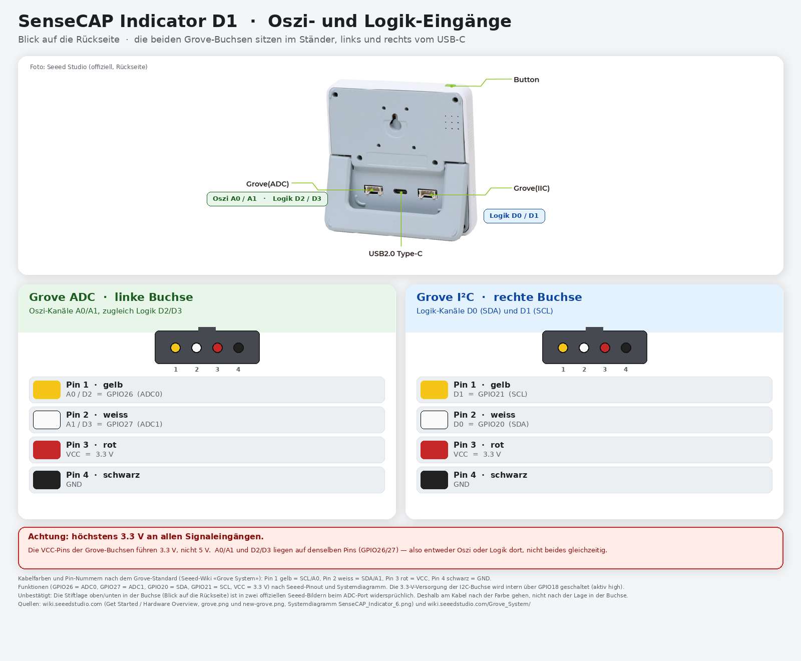
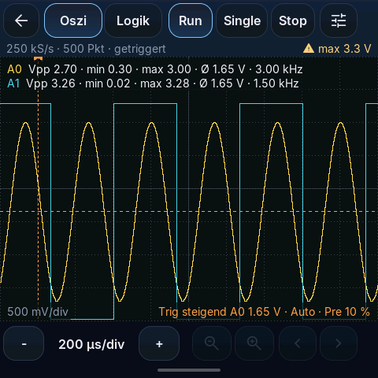
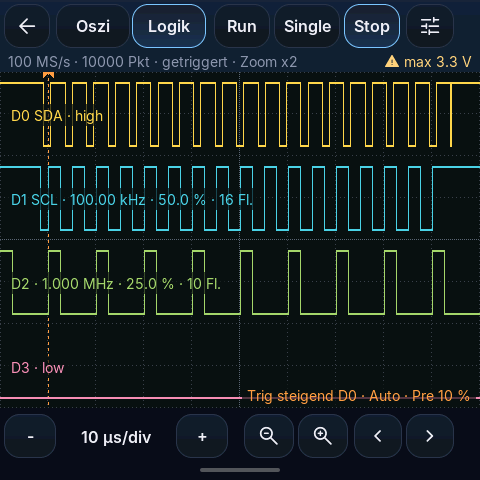
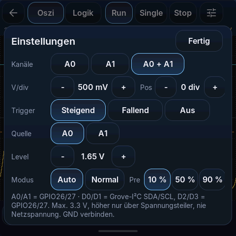

# SenseCAP Indicator D1 – Geräteanleitung

4-Zoll-Tischgerät (480×480) von Seeed Studio mit Ständer. Neben den normalen Panel-Funktionen hat es ein **Oszilloskop** und einen **Logik-Analysator**. Bedienung und Einstellungen stehen in [allgemein.md](allgemein.md).

## Anschluss und Stromversorgung

- Versorgung über die **USB-C-Buchse** hinten im Ständer (5-V-USB-Netzteil).
- Hinten befindet sich auch die Taste des Geräts. Links und rechts der USB-C-Buchse sitzen die beiden **Grove-Buchsen** für die Messeingänge.
- Nach dem Einschalten erscheint nach wenigen Sekunden die Startseite.

## Besonderheiten

- Kein Relais. Die Taste **Schalter** auf der Startseite bedient einen Loxone-Baustein (Einstellungen › Orte & Infos › Schalter-Taste).
- Auf der Startseite gibt es eine zusätzliche Taste für **Oszi / Logik** (vor den Einstellungen).
- Die eingebauten Luftsensoren des D1 werden von dieser Firmware nicht angezeigt.

---

## Oszi / Logik

Die Seite öffnest du mit der Oszi-Taste auf der Startseite. Zurück geht es mit dem Pfeil oben links oder durch Wischen nach rechts.

### ⚠ Sicherheit: höchstens 3,3 V

- An **keinem** Eingang mehr als **3,3 V** oder weniger als 0 V anlegen. Höhere Spannung zerstört das Gerät.
- Höhere Spannungen nur über einen passenden **Spannungsteiler** messen.
- **Nie Netzspannung** (230 V) messen, auch nicht über einen Teiler.
- Die Masse (GND, schwarzes Kabel) mit der Masse der Schaltung verbinden.
- Das D1 ist über USB mit dem Netzteil bzw. Computer verbunden. Verbinde GND nur mit einer Masse, die keinen Bezug zum Stromnetz hat.
- Die rote Ader (3,3 V) nicht anschliessen.

### Eingänge (Grove-Buchsen)

| Buchse (Blick auf die Rückseite) | Kabelfarbe | Oszi | Logik |
|---|---|---|---|
| links „ADC“ | gelb | **A0** | D2 |
| links „ADC“ | weiss | **A1** | D3 |
| rechts „I²C“ | weiss | – | **D0** (SDA) |
| rechts „I²C“ | gelb | – | **D1** (SCL) |
| beide | schwarz | GND | GND |
| beide | rot | 3,3 V, nicht verwenden | |

- A0/A1 und D2/D3 liegen auf denselben Adern. Diese Kabel misst du entweder analog (Oszi) oder digital (Logik).
- An der rechten Buchse hängen auch die internen Sensoren. Der Logik-Analysator kann dort mitlesen, ein fremdes Signal darf dort aber nicht eingespeist werden.
- Die Lage der Stifte in der Buchse ist bei Seeed nicht eindeutig dokumentiert. Richte dich nach der **Kabelfarbe**.

### Oszilloskop

- Bis zu zwei Kanäle (A0, A1), 0–3,3 V.
- Abtastrate bis 500'000 Messungen pro Sekunde (bei zwei Kanälen je 250'000). Saubere Kurven bis etwa 50 kHz.
- Oben: **Oszi | Logik** umschalten, **Run** (laufend), **Single** (eine Aufnahme), **Stop**, Einstellungen.
- Auf der Kurve: Spitze-Spitze, Minimum, Maximum, Mittelwert und Frequenz je Kanal.
- Unten: Zeitbasis (− / +), Zoom und Verschieben innerhalb der Aufnahme.

### Logik-Analysator

- Vier digitale Kanäle D0–D3, bis zu 100 Millionen Messungen pro Sekunde.
- Je Kanal: Pegel (high/low), Frequenz, Tastgrad und Anzahl Flanken.
- Gut geeignet für serielle Signale (UART, I²C) und Taktsignale.

### Einstellungen der Messung

| Einstellung | Auswahl |
|---|---|
| Kanäle | A0, A1, A0 + A1 |
| V/div | 100 mV bis 2 V pro Teilung, dazu die Lage (Pos) |
| Trigger | Steigend, Fallend, Aus |
| Quelle | Kanal, auf den getriggert wird |
| Level | Spannung, bei der getriggert wird |
| Modus | **Auto** (zeigt auch ohne Trigger etwas an) oder **Normal** (wartet auf den Trigger) |
| Pre | Lage des Triggerpunkts: 10 %, 50 % oder 90 % |

Mit **Fertig** schliesst du die Einstellungen.

### Meldungen

| Meldung | Bedeutung |
|---|---|
| „Verbinde mit dem RP2040 …“ | Die Seite baut die Verbindung zum Messteil auf |
| „RP2040 antwortet nicht – Scope-Firmware fehlt?“ | Auf dem Messteil ist die Oszi-Firmware nicht installiert. Bitte an deinen Installateur wenden. Das restliche Panel funktioniert normal |
| „warte auf Trigger …“ | Modus Normal: Das Signal hat den Triggerpegel noch nicht erreicht |
| „Auto, kein Trigger“ | Modus Auto: Es wurde ohne Trigger aufgezeichnet |
| Ein offener Eingang zeigt eine zufällige Spannung | normal, solange nichts angeschlossen ist |

*Die Bilder dieses Abschnitts sind Vorschauen mit Beispieldaten.*

---

## Updates

Der D1 erhält Updates über **Firmware prüfen** (siehe [allgemein.md](allgemein.md#7-updates)). Die Firmware des Messteils (RP2040) ist davon getrennt und wird nicht automatisch aktualisiert.
